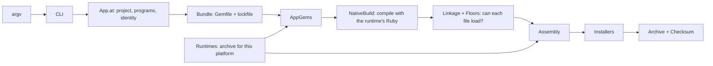

# Fledge's architecture

These documents map Fledge's design for the people who change it: its parts, its concepts, how the pieces fit, the traps, and what it deliberately doesn't do. They save you reading all the code before you know where to look, and never restate it; the code and its tests are the detail. The few decisions that are expensive to undo, and their reasons, are in [the ADRs](#architecture-decision-records).

## What the design answers to

When two parts of the design pull apart, these settle it:

1. **A person who runs the app never meets Ruby.** No install step, no message that mentions Ruby, and no Ruby they happen to have changes the app (ADR 001).
2. **The app's Ruby runs as it does under `ruby main.rb`, or `bundle exec`,** on every desktop and every phone. A difference is a bug unless Fledge records why it must be (see [Parity](parity.md)).
3. **Fledge gives the app nothing to call.** No helpers, no bridges, no APIs. When an app's pure Ruby can't do something on a platform, the fix is a truer Ruby there, never a library of Fledge's (ADR 105). A GUI toolkit, a game framework, or a bridge to Objective-C or Java is the app's or a gem's.
4. **Each platform's app is built on a computer of that platform, with that platform's tools.** No cross-building, and no emulated toolchains.
5. **Every external input is pinned** by version, and by SHA-256 where it is downloaded: runtimes, gems, Ruby's source, toolchains, container images.
6. **Code is a liability.** Use a maintained tool or gem before writing one; what Fledge writes is the order of other tools' commands, and the checks between them.
7. **A runtime carries no copyleft obligation beyond its notices** (see [License audit](license-audit.md)). The gems an app depends on are the app developer's, and Fledge judges none by its license.

## The parts

| Part | What it does | Where | Design |
| - | - | - | - |
| Interface | the `fledge` command, `fledge.kdl`, and the model of a project, its programs, and their identity | `exe/fledge`, `lib/fledge/cli*`, `config*`, `app*`, `identity.rb`, `platform.rb`, `mobile_platform.rb`, `icon.rb` | [interface.md](interface.md) |
| Gems | turns `Gemfile.lock` into the files an app's gems are, compiled for the runtime, and judges whether each compiled file can load | `bundle*`, `app_gems.rb`, `gem_*`, `git_*`, `path_*`, `locked_gem.rb`, `compiled_gem.rb`, `native_build*`, `linkage*`, `binary*`, `carried_libraries*`, `visual_c_runtime.rb` | [gems.md](gems.md) |
| Desktop apps | lays a runtime, a project, and gems out as an app folder, then its bundle, installers, and archive | `assembly*`, `mac_bundle.rb`, `desktop_entry.rb`, `shared_mime_info.rb`, `windows_resources.rb`, `installers.rb`, `dmg.rb`, `nsis*`, `app_image.rb`, `deb.rb`, `msix.rb`, `built_app.rb`, `archive.rb`, `checksum.rb`, `cache_tag.rb`, `entry.rb` | [desktop-apps.md](desktop-apps.md) |
| Signing | signs a desktop app's code, and has Apple notarize it | `signing.rb`, `mac_signing.rb`, `windows_signing.rb`, `sign_command.rb`, `notary.rb`, `windows_sdk.rb` | [signing.md](signing.md) |
| Runtimes | finds, downloads, and checks a release's runtime; builds runtimes from pinned inputs | `runtimes.rb`, `runtime_contents.rb`, `download*`, `lib/fledge/SHA256SUMS`, `tasks/runtime_builder*`, `runtime/sources.yml`, `runtime/rubygems` | [runtimes.md](runtimes.md) |
| Launcher | the C program a person runs, which starts Ruby on the app's program | `runtime/launcher` | [launcher.md](launcher.md) |
| Phone projects | writes an Xcode or Gradle project, compiles gems' extensions for phones, and runs a program on a Simulator or emulator | `mobile_project*`, `mobile_extensions*`, `phone_run*`, `lib/fledge/templates` | [phone-projects.md](phone-projects.md) |
| Phone runtimes | Ruby as a library for iOS and Android, and the C and Java that embed it | `runtime/mobile`, `tasks/runtime_builder/{mobile,ios,android}.rb` | [phone-runtimes.md](phone-runtimes.md) |
| License audit | refuses a runtime that breaks the license policy, and writes its notices and SBOM | `tasks/license_audit*`, `runtime/licenses.yml`, `runtime/audited.yml`, `lib/fledge/license_policy.rb`, `tasks/licensing_page.rb` | [license-audit.md](license-audit.md) |
| Parity | compares what a built app's Ruby sees with `ruby main.rb` | `tasks/parity*`, `tasks/mobile_parity*`, `tasks/ruby_spec*` | [parity.md](parity.md) |
| Project tools | keeps pins current, keeps `trunk` green, and cuts releases | `tasks/pin_*`, `runtime/upstreams.yml`, `tasks/build_cop.rb`, `tasks/ci_runs.rb`, `tasks/release_*`, `tasks/runtime_pins.rb`, `tasks/setup.rb`, `tasks/fast_check.rb`, `tasks/test_tiers.rb` | [project-tools.md](project-tools.md) |

Everything under `lib/` ships in the gem and runs on the developer's computer. `runtime/` holds two kinds of file. The code in `runtime/launcher`, `runtime/mobile`, and `runtime/rubygems` is compiled or installed into a runtime when one is built, and so reaches every app. The YAML files beside those folders never reach an app: `sources.yml` pins the inputs a runtime build reads, `licenses.yml` is the license map the audit checks a runtime against, `audited.yml` is generated with what the audit found, and `upstreams.yml` lists where the project behind each pin publishes its releases. Everything under `tasks/` is Fledge's tooling, run by its CI and contributors, and never ships.

## How a desktop build flows

<!-- SPDX-SnippetBegin -->
<!--
  SPDX-FileCopyrightText: 2026 setdef <kerrick@setdef.com>
  SPDX-License-Identifier: MIT-0
-->

<!-- SPDX-SnippetEnd -->

1. **CLI** parses the command line and picks the platform: always this computer's, `Platform.local`.
2. **`App.at`** finds the project's root from the path given, reads `fledge.kdl` into a `Config`, and resolves the programs to build and each one's `Identity`.
3. **`Runtimes`** finds the runtime archive for the platform, downloading and checking it when needed, and `RuntimeContents` reads what it holds (its Ruby version, gem folder, libraries) without unpacking it.
4. **`Bundle`** reads the `Gemfile` and lockfile as Bundler does, frozen, and **`AppGems`** turns the locked gems for this platform into packages: `.gem` files fetched and checked, git checkouts, and folders.
5. **`NativeBuild`** compiles the packages with extensions by running the runtime's Ruby and RubyGems, and writes the gems' executables.
6. **`Linkage`** and **`NativeBuild::Floors`** read every compiled file and refuse those that couldn't load on another computer of the platform, or warn when one raises the glibc floor. **`CarriedLibraries`** and **`VisualCRuntime`** add what `fledge.kdl` says the app carries.
7. **`Assembly`** unpacks the runtime, lays the runtime, the project, and the gems out as the app folder (inside a macOS bundle for a windowed Mac app), writes `fledge.cfg`, places a launcher per program, and signs.
8. **`Installers`** writes each installer the app gets, then **`Archive`** packs the folder and **`Checksum`** writes a `.sha256` beside each file. The CLI prints each path.

`fledge build --from` replaces steps 3 to 6 with **`BuiltApp`**, which takes the runtime, gems, and launchers from an app fledge built.

## How a phone build flows

The same steps 1 to 4, for a `MobilePlatform` instead of a `Platform`, with every gem's source build. Then **`MobileExtensions`** compiles each gem's extension for each phone target with the phone's toolchain, **`MobileProject`** copies Fledge's template project, places the phone runtime, the project, the gems, and the linked extensions in it, lays the host over it, and runs XcodeGen or checks the Gradle project. **`PhoneRun`** builds that project, installs it on a Simulator or device, and follows its log. See [Phone projects](phone-projects.md).

## Concepts

- **Platform:** where an app runs, named as RubyGems names it (`x86_64-linux`, `arm64-darwin`, `x64-mingw-ucrt`), or `ios` or `android`. `Platform` and `MobilePlatform` answer each part's questions about it: its archive format, its executables' names, its oldest macOS or glibc, its lockfile names.
- **Runtime:** an archive of a relocatable CRuby, Fledge's launchers, the tools a build needs on that platform, and notices, built by Fledge's CI and pinned by SHA-256 in the gem.
- **Project:** the folder an app's files come from, found from the path the developer gives. It is copied whole into the app's `app` folder, less `.git`, Bundler's folders, and folders a `CACHEDIR.TAG` marks.
- **Program:** one file of the project that a launcher runs, with its **identity**: name, kind, identifier, version, icon, and what the systems show. A project has one program, or the several `fledge.kdl` lists.
- **App:** the folder a build writes, in which every program shares one runtime, one project, and one set of gems.
- **`fledge.cfg`:** the file Assembly writes and the launcher reads: each program's entry, the Gemfile, and what the launcher checks before Ruby starts. It is the contract between `lib/` and `runtime/launcher` (and `runtime/mobile`), so a change to its keys changes both sides.
- **Entry:** `Entry`, a file, folder, or link to write into an app at a relative path, refusing any path that could leave the app. Every part that adds files to an app produces entries.

## Conventions every part follows

- **Errors say what to change.** A failure the developer can fix raises `Fledge::Error` with a message that says which file and which value to change, and how; the CLI prints it prefixed with the command and exits 1. A mistake on the command line raises `UsageError`, which exits 2 with the usage. A backtrace is a bug.
- **Standard output is the result.** Only the paths of the files a person would hand over go to standard output; progress, warnings, and anything a gemspec or Gemfile prints go to standard error (`Evaluation.to_stderr` holds standard output for that).
- **Subprocesses take arrays,** through `Command.run` and `Command.read`, which name the tool to install when it can't run. No string reaches a shell, except a signing command the developer wrote for the shell.
- **Values are `Data.define`,** with validation in their constructors, and entities are plain classes.
- **Nothing a developer's Ruby sets reaches a build's Ruby.** A subprocess that runs a Ruby gets `RUBY*`, `GEM_*`, `BUNDLE_*`, `BUNDLER_*`, `GEMRC`, and `RI_FORCE_PATH_FOR_DLL` cleared (`NativeBuild::SCRUBBED`), as the launcher sets them aside for the app.

## Traps

- **Bundler is global.** Its settings and root are process state. Anything that evaluates a Gemfile does it inside `Bundle#at_project` or the like, which sets `BUNDLE_GEMFILE`, resets Bundler, and restores both, so that the developer's Bundler setup, which is running fledge, is left as it was.
- **A gemspec runs code.** Evaluating one can print, require project files, or depend on what the Gemfile loaded. `Bundle::GemspecLoads` runs that evaluation in a child Ruby, to record what it loaded and ship it with the evaluated gemspec.
- **Paths on Windows.** Work folders go through `LongPath.of`, so that a gem compiles in a folder spelled with its long names, however the temporary folder is spelled; paths handed to Windows programs go through `Nsis.host_path`.
- **A platform's tool belongs in an integration test.** A test in `test/integration` is an integration test, and every other test is a unit test. `tasks/test_tiers.rb` makes the split, and refuses a unit test that reads a runtime a build left behind ([Project tools](project-tools.md)). A test that runs a platform's tool, as `test/integration/dmg_test.rb` and `mac_signing_test.rb` do, goes in `test/integration`, since the tool exists only on its platform.

## What Fledge deliberately doesn't do

- Build for a platform other than the one it runs on (a desktop's `--target` is refused with that reason).
- Give an app's Ruby a module, method, bridge, or screen of Fledge's, on a desktop or a phone.
- Make the app a single file that unpacks itself or mounts a file system to start (ADR 001). The app is a folder that runs as it is. An AppImage wraps that folder for people who want one file, and AppImage's runtime, not Fledge's launcher, mounts it.
- Judge an app's gems by their licenses.
- Sign Linux apps, sign phone apps, or publish to any store.
- Give a console app installers.

## Architecture decision records

ADRs live in [`docs/contributors/adr`](../adr). Each records one decision that is expensive to undo, its drivers, the options weighed, and its consequences:

- [ADR 001](../adr/001.md): ship an app as a C launcher that embeds CRuby, beside a relocatable Ruby.
- [ADR 093](../adr/093.md): prebuild each platform's runtime in Fledge's CI, and publish it with the release, pinned by SHA-256 in the gem.
- [ADR 099](../adr/099.md): on a phone, build Ruby from source with Ruby's `configure` and `make`, as an XCFramework and an AAR.
- [ADR 105](../adr/105.md): on a phone, the app's Ruby drives the platform's widgets from the main thread, with only what Ruby gives every program.

Software design that refactoring can change cheaply belongs in these design documents, not in an ADR. Write an ADR only for a decision whose reversal would mean rebuilding a part, such as the shape of a runtime or what an app may call.
